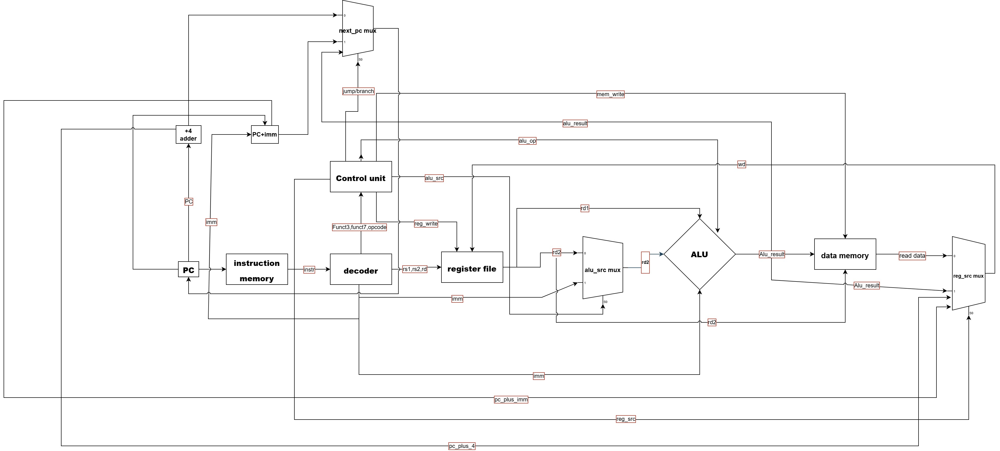

# Single-Cycle Datapath

**Goal:** wire together every module built so far — `pc_counter`, `inst_memory`, `decoder`, `control_unit`, `reg_file`, `alu`, `data_mem` — into one top-level single-cycle RV32I core, plus the glue logic that doesn't belong inside any individual module (two dedicated adders and three muxes). Covers R-type, I-type (arithmetic + load), S-type, B-type, U-type (`lui` + `auipc`), and J-type/`jalr` — 8 instruction formats, 15+ distinct instructions.



## Structure

```systemverilog
module datapath(
  input logic clk,
  input logic reset
);

  // ===== Fetch =====
  logic [31:0] pc, next_pc, instr, pc_plus_4;
  assign pc_plus_4 = pc + 32'd4;

  pc_counter PC(.clk(clk), .reset(reset), .next_pc(next_pc), .pc(pc));
  inst_memory ITEM(.addr(pc), .instr(instr));

  // ===== Decode =====
  logic [6:0] opcode; logic [4:0] rd, rs1, rs2; logic [2:0] funct3; logic [6:0] funct7; logic [31:0] imm;
  decoder D0(.instr(instr), .opcode(opcode), .rd(rd), .rs1(rs1), .rs2(rs2), .funct3(funct3), .funct7(funct7), .imm(imm));

  logic [3:0] alu_op; logic reg_write, alu_src, mem_write, branch, jump; logic [1:0] reg_src;
  control_unit CONTROL(.opcode(opcode), .funct3(funct3), .funct7(funct7), .alu_op(alu_op), .reg_write(reg_write), .alu_src(alu_src), .mem_write(mem_write), .branch(branch), .jump(jump), .reg_src(reg_src));

  // ===== Register Read =====
  logic [31:0] rd1, rd2, wd;
  reg_file REGISTERS(.clk(clk), .reset(reset), .we(reg_write), .rs1(rs1), .rs2(rs2), .rd(rd), .wd(wd), .rd1(rd1), .rd2(rd2));

  // ===== Execute =====
  logic [31:0] alu_b, alu_result;
  assign alu_b = (alu_src==1) ? imm : rd2;
  alu EXECUTE(.a(rd1), .b(alu_b), .alu_op(alu_op), .result(alu_result));

  // ===== Memory =====
  logic [31:0] mem_read_data;
  data_mem DM0(.clk(clk), .mem_write(mem_write), .reset(reset), .addr(alu_result), .write_data(rd2), .read_data(mem_read_data));

  // ===== PC update =====
  logic [31:0] pc_plus_imm;
  assign pc_plus_imm = pc + imm;

  // ===== Write-back =====
  always_comb begin
    case(reg_src)
      2'b00: wd = alu_result;
      2'b01: wd = pc_plus_4;
      2'b10: wd = mem_read_data;
      2'b11: wd = pc_plus_imm;
      default: wd = alu_result;
    endcase
  end

  // next_pc: priority-ordered (jalr > jump > branch-taken > default pc+4)
  always_comb begin
    if (opcode == 7'b1100111)           // jalr: target is register-relative, already in alu_result
      next_pc = alu_result;
    else if (jump == 1'b1)              // jal: target is PC-relative
      next_pc = pc_plus_imm;
    else if (branch == 1'b1) begin      // conditional branch: taken/not-taken decided per funct3
      case(funct3)
        3'b000: next_pc = (alu_result==0) ? pc_plus_imm : pc_plus_4; // beq
        3'b001: next_pc = (alu_result!=0) ? pc_plus_imm : pc_plus_4; // bne
        3'b100: next_pc = (alu_result==1) ? pc_plus_imm : pc_plus_4; // blt
        3'b101: next_pc = (alu_result==0) ? pc_plus_imm : pc_plus_4; // bge
        3'b110: next_pc = (alu_result==1) ? pc_plus_imm : pc_plus_4; // bltu
        3'b111: next_pc = (alu_result==0) ? pc_plus_imm : pc_plus_4; // bgeu
        default: next_pc = pc_plus_4;
      endcase
    end
    else
      next_pc = pc_plus_4;
  end

endmodule
```

## Concepts practiced

- **The two muxes aren't arbitrary — each exists because one wire has to carry more than one possible value.** `alu_b` can come from a register (`rd2`) or the decoded immediate, depending on instruction (`alu_src`). `wd` can come from the ALU result, `pc+4` (for `jal`/`jalr` return addresses), memory read data (for `lw`), or `pc+imm` (for `auipc`), depending on instruction (`reg_src`, 2 bits for 4 sources). `next_pc` can be `pc+4`, a branch/jump target, or an `jalr` target.
- **`jalr`'s target comes from the existing ALU; `jal`'s target needs a brand-new adder.** `jalr`'s target is register-relative (`rs1+imm`) — the ALU already computes exactly that (`alu_src=1`, `alu_op=ADD`), so no new hardware is needed, and `next_pc` just reads `alu_result` directly when `opcode` identifies a `jalr`. `jal`'s target is PC-relative (`pc+imm`) — the ALU has no PC input at all, so a dedicated `pc_plus_imm` adder was built specifically for this (and reused for taken branches and `auipc`'s write-back value).
- **A `jalr`-detection signal was deliberately *not* added to `control_unit`.** `jalr` already sets `jump=1` (shared with `jal`), and distinguishing the two in `datapath`'s `next_pc` logic only needs one more piece of information: `opcode`, which `decoder` already outputs. Checking `opcode==7'b1100111` directly reuses an existing wire instead of adding a redundant control bit.
- **Address vs. value, a recurring source of real bugs during wiring:** `rd`/`rs1`/`rs2` are 5-bit register *addresses* (which slot to read/write); `rd1`/`rd2`/`wd`/`alu_result` are the 32-bit *values* stored at those addresses. These look similar in a signal list and got crossed with each other repeatedly while hooking up `reg_file`, `alu`, and `data_mem` (see Mistakes below) — the fix each time was going back to "what does this wire actually carry, a slot number or a 32-bit value?"
- **Single shared clock domain.** Every `always_ff` submodule (`pc_counter`, `reg_file`, `data_mem`) takes the *same* `clk`/`reset` passed down through `datapath`'s own ports — unlike the standalone per-module testbenches used earlier, which each drove their own independent clock.

## Verification

Simulated with Icarus Verilog (`iverilog -g2012`) against a 12-instruction hand-assembled test program, hand-encoded to RV32I hex (`auipc`, `addi`, `add`, `sw`, `lw`, `beq`, `jal`), covering: reset behavior, arithmetic, store/load round-trip, a taken branch (correctly skipping the next instruction), and `jal`/return-address semantics (correctly skipping the instruction its own target jumps past):

```
addr 0:  auipc x10,0          // x10 = pc(0) + 0 = 0
addr 4:  addi  x10,x10,0      // x10 = 0
addr 8:  addi  x5,x0,10       // x5 = 10
addr 12: addi  x6,x0,20       // x6 = 20
addr 16: add   x7,x5,x6       // x7 = 30
addr 20: sw    x7,0(x10)      // mem[0] = 30
addr 24: lw    x8,0(x10)      // x8 = 30
addr 28: beq   x7,x8,8        // 30==30, branch taken -> addr 36
addr 32: addi  x9,x0,99       // SKIPPED by the branch
addr 36: jal   x1,8           // x1 = 40 (return addr), jump -> addr 44
addr 40: addi  x10,x0,55      // SKIPPED by the jump
addr 44: addi  x11,x0,77      // executed
```

```
PASS: reset successful x10=0 x5=0 x6=0 x7=0 mem0=0 x8=0 x9=0 x1=0 x11=0
PASS: x10 = 0
PASS: x5 = 10
PASS: x6 = 20
PASS: x7 = 30
PASS: mem0 = 30
PASS: x8 = 30
PASS: x9 = 0
PASS: x1 = 40
PASS: x11 = 77
```

All 12 instructions produced the hand-traced expected values on the first fully-correct run.

**Extended afterwards** with 6 more instructions appended (without touching the original program), to cover branch directions the first pass never exercised — `beq`-not-taken (`x11` vs `x7`, unequal), `bne`-taken (`x5` vs `x6`), and `bne`-not-taken (`x5` vs `x5`):

```
addr 48: beq  x11,x7,8   // 77!=30, not taken -> addr 52
addr 52: addi x11,x11,10 // x11 = 87
addr 56: bne  x5,x6,8    // 10!=20, taken -> addr 64
addr 60: addi x5,x5,10   // SKIPPED by the branch
addr 64: bne  x5,x5,8    // equal, not taken -> addr 68
addr 68: addi x5,x5,20   // x5 = 30
```

All 18 checks (9 after the first block, 9 after the extension) pass. See Mistakes below for a real bug this extension caught — a wrong clock-cycle count in the *original* test that had gone unnoticed.

**Note on `reg_file`'s reset and Icarus:** `reg_file.sv` resets its `regs` array with `regs <= '0;`, which is standard SystemVerilog but **not supported by Icarus Verilog** (errors with "Assignment to an entire array...is not yet supported"). `tb.sv` as committed here was actually simulated against a local copy of `reg_file` with that one line swapped for an equivalent `for` loop (see `register_file`'s README for the loop). The RTL in `riscv-core-alu-regfile/` is kept as `'0` since that's the better, more standard form and works fine in Vivado/Questa/VCS — only Icarus needs the workaround.

## Mistakes caught along the way

- Instantiation syntax slips: missing leading `.` on a port connection (`alu_op(alu_op)` instead of `.alu_op(alu_op)`), a stray mid-identifier typo (`.branc.h` instead of `.branch`), missing closing parentheses on a couple of instantiations.
- **Multiple-driver bugs, the single most common bug class in this build** — assigning to a wire that's already driven by a module's own output port: `alu_src` mux output accidentally written to `rd2` (already driven by `reg_file`), ALU result accidentally assigned to `rd` (the *address* wire, not a new value wire), `data_mem`'s read output accidentally assigned to `rd2` again, and — twice — `pc`/`next_pc` confused for each other inside the PC-update logic (`pc` is `pc_counter`'s own output; only `next_pc` may be driven from outside it). Every one of these was fixed by introducing a fresh, uniquely-named wire (`alu_b`, `alu_result`, `mem_read_data`) instead of reusing an existing one.
- Address/value mix-ups while wiring `reg_file`'s and `data_mem`'s instantiations: `.write_data(rd)` instead of `.write_data(rd2)` (wrote the destination *address* into memory instead of the register's *value*); `.addr(rd)` proposed for `data_mem`'s address port, then self-corrected after recalling the ALU already computes `rs1+offset` for loads/stores, so `alu_result` (not `rd` or `pc`) is the right address.
- `case(funct3) begin` — `begin` is not valid directly after a `case(...)` statement.
- Branch-case literals initially written as bare decimal (`000`, `001`, ...) instead of `3'b000`, `3'b001`, ... — without the `3'b` prefix these are read as decimal numbers, not binary patterns, silently matching the wrong (or no) case.
- An early version kept a leftover `assign next_pc = pc_plus_4;` in the Fetch section from before the full priority-ordered PC-update block existed — a second driver conflict with that block, caught and removed once the full `jalr`/`jump`/`branch` priority chain was in place.
- The `next_pc` priority logic was initially branch-only, missing `jump`/`jalr` handling entirely — expanded into the full `jalr > jump > branch-taken > default` chain once `jal`/`jalr` reached this stage of the build.
- **A real, latent bug found only when extending the test — wrong `repeat()` cycle count.** The original testbench used `repeat(12)` to run the 12-instruction program, but the program's `beq`-taken and `jal` each skip one instruction, so only **10** clock cycles are actually needed to reach the end — `repeat(12)` silently ran 2 extra cycles against still-uninitialized memory (`X`). Those 2 cycles decoded to an unmatched opcode, fell through to `control_unit`'s `default` case (`reg_write=0`), and were harmless **as long as nothing real lived at those addresses** — so the bug never showed up as a FAIL. The moment 6 new instructions were appended right after the original program, those same 2 leftover cycles silently consumed the first two of them (`beq`-not-taken and the following `addi` never executed), and the final `x11` value came out wrong. Fixed by counting cycles as *dynamic* (actually executed) instructions rather than the static count in the source: `repeat(10)` for the original block, `repeat(5)` for the extension (its own `bne`-taken also skips one instruction). Caught by adding temporary `$display` prints of `pc`/`instr` each cycle and tracing where execution actually went — a reminder that a test passing doesn't mean the test itself is correct, only that whatever it happened to check came out right.

## Diagram

`datapath-diagram.png` — hand-drawn in draw.io (not auto-generated), traced block-by-block against this file: PC → Instruction Memory → Decoder → Control Unit / Register File → `alu_src` mux → ALU → Data Memory → `reg_src` mux → write-back to Register File, plus the PC-update loop (`+4` adder, `PC+imm` adder, `next_pc` mux) and all 6 Control Unit signal fan-outs.
